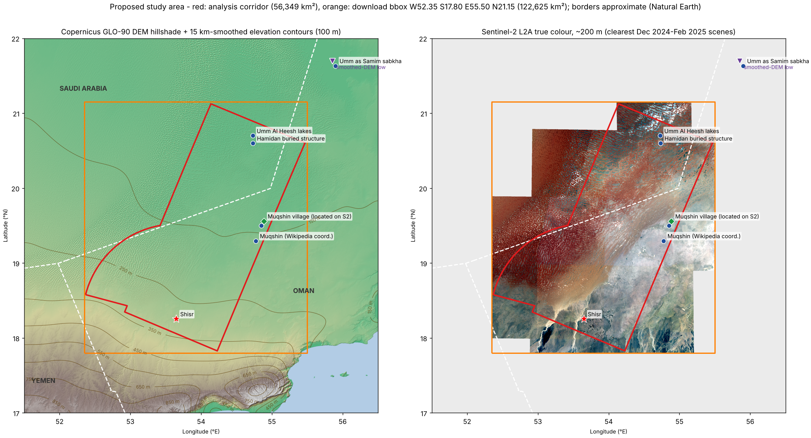

# Southern Rub' al-Khali geoarchaeology — desk-based remote-sensing screen

**Question tested.** Can free satellite data pick out *candidate* locations for ancient
settlements (possibly linked to the people of ʿĀd described in the Qur'an) where
north-draining wadis from the Dhofar plateau run into the sands of the Rub' al-Khali?

**Ground rules.**
- Everything this project produces is a **candidate** for expert review, never a discovery.
- Every anomaly is reported with its natural or modern explanations: geology, dunes,
  sabkhas, modern tracks, farms, seismic lines and oil infrastructure.
- This is a sensitive border region (Oman–Saudi Arabia–Yemen). The project is **desk
  research only**: no field-visit planning, access routes or logistics.
- Downloads over 5 GB need approval first.

## Results and outputs

| Output | File |
|---|---|
| **Arabic presentation of the findings (PDF, 19 slides)** | [`outputs/presentation/rub_al_khali_findings_ar.pdf`](outputs/presentation/rub_al_khali_findings_ar.pdf) |
| Interactive map: all layers, live weight sliders, top-N re-ranking, CSV export | [`outputs/maps/rub_al_khali_candidates.html`](outputs/maps/rub_al_khali_candidates.html) (download and open in a browser) |
| Top-20 candidate table: coordinates, score, clues, natural explanations | [`outputs/candidates/top20_candidates.csv`](outputs/candidates/top20_candidates.csv) |
| Candidate snapshots (4 × 4 km, six panels each) | [`outputs/candidates/snapshots/`](outputs/candidates/snapshots/) |
| Report: method, limitations, false-positive risks | [`reports/report.md`](reports/report.md) |

**Headline:** free 10–90 m data show **no conclusive evidence** of settlements. The 20 candidates cluster in three
settings:

1. the sand front 30–90 km north and north-west of Shisr, where wadis end under the dunes;
2. the north-west fan near the Maitan Neolithic sites;
3. sabkhas east of Umm Al Heesh.

Their strongest signals are natural ones. See the report.

## Status

| Step | Script | State |
|---|---|---|
| 1–4. Study area, preview data, study-area map, reference checks | `01`–`04` | done |
| 5. 30 m DEM and UTM 40N analysis grids | `05_fetch_dem30_grids.py` | done |
| 6. Sentinel-2 corridor bands (one date per orbit, cross-orbit matching) | `06_fetch_sentinel2.py` | done |
| 7. Indices, sand mask, pale-crust proxy | `07_sand_minerals.py` | done |
| 8. Drainage, wadi ends under dunes, sub-dune base surface, buried courses | `08_hydrology_dunes.py` | done |
| 9. Sentinel-1 backscatter and coherence | `09_sentinel1.py` | done |
| 10. Landsat-1 MSS 1972–73 vs Sentinel-2 sand change | `10_landsat_sand_change.py` | done |
| 11. Modern infrastructure masks | `11_modern_infrastructure.py` | done |
| 12. Line, corner and circle anomalies; Shisr tracks | `12_anomalies_tracks.py` | done |
| 13. ASTER indices via Earth Engine | `13_aster_gee.py` | **written, not run** (needs `EE_SERVICE_ACCOUNT_JSON`) |
| 14. Published site coordinates (Zenodo/OSF) | `14_published_sites.py` | **written, not run** (needs zenodo.org, osf.io, files.osf.io allowed) |
| 15. Weighted score and top-20 candidates | `15_score_candidates.py` | done |
| 16. Candidate snapshots | `16_snapshots.py` | done |
| 17. Interactive map | `17_interactive_map.py` | done (tested in headless Chromium) |
| 18–19. Arabic presentation figures and PDF | `18_presentation_figures.py`, `19_presentation_pdf.py` | done |

**Data volume:** about 10.4 GB was transferred in total, above the 4–5 GB estimated at the checkpoint, though no
single download exceeded 5 GB. The excess came from a second Sentinel-2 corridor read, needed to remove date seams,
plus preview iterations and verification chips.

## Study area (approved)



Interactive map: [`outputs/maps/00_study_area.html`](outputs/maps/00_study_area.html).
Download the file and open it in a browser. The DEM and Sentinel-2 layers are embedded;
the Esri and OSM base maps load online.

| | Extent | Area |
|---|---|---|
| **Analysis corridor** | 150 km wide band from Shisr to Umm Al Heesh (bearing 22.6°, 293.5 km), extended 20 km past each end, plus a 140 km fan north-west of Shisr (bearings 285°–360°) | 56,349 km² |
| **Download box** | W 52.35, S 17.80, E 55.50, N 21.15 | 122,625 km² |
| 30 m DEM extent | the download box extended south to 17.0°N, to include whole wadi catchments | — |
| Context box (90 m DEM only) | 51.5–56.5°E, 17–22°N, covering the groundwater path to Umm as Samim | 290,418 km² |

Only pixels inside the corridor are analysed. The box sets which tiles are touched.

### Reference points and how they were checked

Full table with sources: [`data/reference/reference_points.csv`](data/reference/reference_points.csv).
Results of the imagery checks: [`data/reference/reference_points_verified.csv`](data/reference/reference_points_verified.csv).
Image chips: [`outputs/figures/reference_chips/`](outputs/figures/reference_chips/), all on one page in
[`outputs/figures/01_reference_checks.png`](outputs/figures/01_reference_checks.png).

| Place | Published coordinate | Imagery check (Sentinel-2 L2A, 10 m) |
|---|---|---|
| Shisr fortress | 18.2550 N, 53.6489 E (Wikipedia) | Falls on the village centre. The site is ringed by **modern centre-pivot fields and a dense network of modern tracks radiating from the village**, which are strong look-alikes for the "circular anomaly" and "radiating track" clues. |
| Umm Al Heesh lakes | 20.70 N, 54.73 E (Arabic Wikipedia) | Dark wetland/lake complex **0.3–1.5 km north** of the point, in an interdune flat, with pale evaporite crusts nearby. Kazak et al. (2025) report the present lake is fed by a **leaking exploration well**, so its water is modern and human-sustained. |
| Hamidan structure | 20°36′N 54°44′E (Neville et al. 2014) | Buried 16 km structure seen in seismic data. It has no clear surface ring (as expected), but a cluster of interdune sabkha flats sits over it. |
| Muqshin oasis | 19.2969 N, 54.7750 E (en.wikipedia) | **Not at this point**: bare sand sheet. A village with a vegetated wadi on the sand edge lies at **19.560 N, 54.885 E**, 8 km from the alternative published coordinate (19°30′N 54°51′E). That position comes from my own image interpretation and is stored as `muqshin_s2`. |
| Umm as Samim | 21°38′N 55°54′E (Wikipedia) | Sabkha flat with dune margins on the 20 m chip. Independent check: the lowest point of the 15 km-smoothed DEM north of 19.5°N falls at 21.70 N, 55.85 E (~61 m), about 8 km away. |
| ʿUruq al-Muʿtariḍah | no centroid published (USGS OFR 82-387) | To be outlined from the DEM, not guessed. |
| Maitan Neolithic sites | no coordinates published (Maiorano et al. 2020) | North of Al-Mazyunah near the tri-border. Covered by the north-west fan. |

**Training and validation sites are the main gap.** Shisr is the only *archaeological*
site inside the corridor with a published coordinate I could verify from this session.
Trilith, tomb and palaeolake coordinates exist in the literature (see *Access needed*) but
were not reachable. Without them, the machine-learning step and the "fit lines through
trilith alignments" step cannot be trained honestly.

## Data sources and access from this environment

| Dataset | Host | Reachable here? | Estimated volume (corridor only) |
|---|---|---|---|
| Copernicus GLO-90 DEM | AWS open data `copernicus-dem-90m` | yes, no key | 137 MB (downloaded) |
| Copernicus GLO-30 DEM, 16 tiles | AWS open data `copernicus-dem-30m` | yes, no key | 630 MB |
| Sentinel-2 L2A Collection 1, one winter scene per tile, B2 B3 B4 B8 B8A B11 B12 + SCL at 20 m | AWS open data `e84-earth-search-sentinel-data` | yes, no key (STAC API blocked; bucket listed directly) | ~1.5–2.5 GB |
| Sentinel-2 10 m windows around candidates | same | yes | ~0.3 GB |
| Sentinel-1 global seasonal backscatter and coherence (Dec 2019–Nov 2020, ~90 m), 13 tiles | AWS open data `sentinel-1-global-coherence-earthbigdata` | yes, no key | ~0.2 GB |
| Landsat Collection 1: MSS 1972–83, TM 1984–2011, OLI 2013–21 | Google Cloud `gcp-public-data-landsat` | yes, no key (0.77 GB scene index is streamed, not stored) | ~1.0–1.5 GB |
| Modern roads, tracks, pipelines (OpenStreetMap via Overture Maps) | AWS open data `overturemaps-us-west-2` | yes, no key | ~0.1–0.5 GB |
| **ASTER** L1T VNIR/SWIR/TIR (SWIR only before April 2008), ASTER GED emissivity, night-time surface temperature (AST_08) | NASA LP DAAC, or Google Earth Engine | **no**: Earthdata hosts are blocked; Earth Engine is reachable but needs credentials | Earth Engine: ~0 GB local; Earthdata: 2–4 GB |
| Full-resolution Sentinel-1 GRD time series | Copernicus Data Space, ASF, or Earth Engine | **no** (blocked or needs an account) | — |
| Published site coordinates (e.g. Dellmour et al. 2026: 125 surveyed localities) | Zenodo / OSF | **no** (blocked) | < 50 MB |

**Total for the open-data analysis: about 4–5 GB**, with no single download over 5 GB.

### Accounts, keys and access needed

Nothing above needs a key except ASTER and full-resolution Sentinel-1. Pick one route:

1. **Google Earth Engine (recommended).** Needs a Google account, a Google Cloud project
   registered for Earth Engine (free for non-commercial research), and a service-account
   JSON key. Store the key as an environment secret named `EE_SERVICE_ACCOUNT_JSON` in
   this cloud environment's settings. Never paste it into chat. Earth Engine's API hosts
   are already reachable from here. This gives ASTER L1T and GED, Sentinel-1 GRD, and
   Landsat Collection 2 including MSS, computed server-side.
2. **NASA Earthdata Login (free).** Needs a token stored as `EARTHDATA_TOKEN`, plus these
   hosts added to the environment's allowed domains: `urs.earthdata.nasa.gov`,
   `cmr.earthdata.nasa.gov`, `data.lpdaac.earthdatacloud.nasa.gov`.

For published site coordinates, also allow `zenodo.org`, `osf.io` and `files.osf.io`
(Dellmour et al. 2026 data and code), and `journals.plos.org` (2025 Dhofar monument survey).

## Analysis method

Regional layers are built at 20–30 m inside the corridor and summarised on a 1 km grid in
UTM 40N. 10 m Sentinel-2 is then read only around the highest-scoring cells.

| # | Clue | Method | Main false positives |
|---|---|---|---|
| 5 | 3. Valleys opening north onto the sands | D8 flow routing on Copernicus DEM. Sand mask from Sentinel-2 colour plus DEM dune texture. Wadi termini are the points where channels enter the sand mask. Buried courses are projected by routing flow over a "sub-dune base surface" interpolated from interdune floors. | Dune-controlled flow paths; DEM artefacts in dunes |
| 6 | 6. Thin or recent sand | Dune height = DEM minus base surface. Sand-cover change from Landsat MSS (1970s), TM (~1990s) and Sentinel-2 (2020s): sand-class persistence plus cross-correlation of dune displacement. | Seasonal sand sheets; differences between sensors |
| 7 | 5. Groundwater path and low points | Closed depressions on the base surface along the Dhofar → Umm Al Heesh / Muʿtariḍah gradient, together with evaporite/sabkha signatures. | Deflation hollows; modern well-fed water (Umm Al Heesh) |
| 8 | 1. Fossil springs (carbonate, gypsum) | ASTER SWIR calcite index (Ninomiya) and TIR carbonate and quartz/sulfate emissivity indices. Fallback if ASTER is unavailable: Sentinel-2 SWIR ratios, which are non-specific and down-weighted. | Lacustrine marls, calcrete, bedrock limestone, sabkha evaporites |
| 9 | 4. Caravan tracks | Linear-feature extraction on Sentinel-2 and Landsat TM; Hough/RANSAC fits of lines converging on Shisr, extended into the dunes; tracks compared against 1970s MSS. | **Modern tracks radiating from Shisr**; seismic lines; pipelines |
| 10 | 2 + 4. Geometric anomalies | Edge detection, rectilinear and circular shape filters, and a simple classifier (random forest) if enough known sites become available. Spatial cross-validation. | Centre pivots, farm plots, well pads, seismic grids, dune slip faces |
| 11 | All | Weighted score per 1 km cell, using editable weights in [`config/weights.yaml`](config/weights.yaml) with modern-infrastructure masks. Top 20 candidates, spaced at least 5 km apart. | — |
| 12 | Outputs | Interactive map, top-20 table with snapshots, and a report on method, limitations and false positives. | — |

## How to run

```bash
python3 -m venv ~/venvs/geoarch && ~/venvs/geoarch/bin/pip install -r requirements.txt
cd scripts
for s in 01_define_aoi 02_fetch_preview_data 03_map_study_area 04_verify_reference_points \
         05_fetch_dem30_grids 06_fetch_sentinel2 07_sand_minerals 08_hydrology_dunes 09_sentinel1 \
         10_landsat_sand_change 11_modern_infrastructure 12_anomalies_tracks \
         15_score_candidates 16_snapshots 17_interactive_map 18_presentation_figures 19_presentation_pdf; do
  ~/venvs/geoarch/bin/python $s.py || break
done
# optional, once access exists: 13_aster_gee.py and 14_published_sites.py, then re-run 15-19
```

- Step 19 renders the PDF with Node and the pre-installed Playwright Chromium (`scripts/render_pdf.js`).
- Edit [`config/aoi.yaml`](config/aoi.yaml) to change the corridor, then re-run from step 1.
- Edit [`config/weights.yaml`](config/weights.yaml) to change the weights, then re-run from step 15.

## Folder layout

```
config/            study-area and scoring parameters
data/raw/          downloads (git-ignored, re-created by scripts)
data/interim/      intermediate rasters (git-ignored)
data/reference/    reference points with sources; borders (Natural Earth 1:10m)
data/processed/    study-area vectors and other small derived layers
scripts/           numbered pipeline steps plus helpers (common.py, s2_catalog.py)
outputs/maps/      interactive HTML maps
outputs/figures/   static figures and image chips
outputs/candidates/ candidate table and snapshots
outputs/presentation/ Arabic PDF deck, its HTML source and figures
reports/           method, limitations and false-positive report
data/reference/fonts/ Noto Sans Arabic (SIL Open Font License) for the Arabic deck
```

## References used so far

- Kazak, E.S., Al Gaoud, A., Ahmed, S.M., Souid, F. & Nabi, A. (2025). Origin of Umm Al Heesh lake in the Rub' Al Khali desert, Saudi Arabia. *Scientific Reports* 15, 34850.
- Neville, A.S., Cook, D.J., Afifi, A.M. & Stewart, S.A. (2014). Five buried crater structures imaged on reflection seismic data in Saudi Arabia. *GeoArabia* 19(1), 17–44. doi:10.2113/geoarabia190117
- Groundwater potential of Ar Rub' Al Khali using CART (2021), *Remote Sensing* 13(12), 2300. Describes the shallow macro-depression around Saih Rawl, Mutaridah and Umm Al Hiesh.
- USGS Open-File Report 82-387. Reconnaissance investigation of brine in the eastern Rub al Khali, Kingdom of Saudi Arabia (Al ʿUruq al Muʿtariḍah–Umm as Samim depression).
- Dellmour, R. et al. (2026). Stone and water governed early human settlement of the desert. *Nature*. doi:10.1038/s41586-026-11180-5. Settlement tracked places where water and tool-stone occur together; the interior crossing found no archaeology. Data on Zenodo 10.5281/zenodo.21758429 and OSF osf.io/4mw23.
- Matter, A., Neubert, E., Preusser, F., Rosenberg, T. & Al-Wagdani, K. (2015). Palaeo-environmental implications derived from lake and sabkha deposits of the southern Rub' al-Khali, Saudi Arabia and Oman. *Quaternary International* 382, 120–131.
- Maiorano, M.P. et al. (2020). Living and moving in Maitan: Neolithic settlements and regional exchanges in the southern Rub' al-Khali (Sultanate of Oman). *Proceedings of the Seminar for Arabian Studies* 50.
- Al Kindi, M., Pickford, M., Gommery, D. & Qatan, A. (2021). Stratigraphy, palaeoclimatic context and fossils of the Southern Rub Al Khali: results of a geo-archaeological survey around the area of Maitan. *Historical Biology* 33(9), 1534–1555.
- Rose, J.I. et al. (2011). The Nubian Complex of Dhofar, Oman. *PLoS ONE* 6(11), e28239.
- Blom, R.G., Crippen, R., Elachi, C. et al. JPL work on Ubar/Shisr caravan tracks with Landsat, SPOT and shuttle radar (1990s; 2000 IEEE IGARSS paper on SRTM and frankincense routes).
- Kellndorfer, J. et al. (2022). Global seasonal Sentinel-1 interferometric coherence and backscatter data set. *Scientific Data* 9, 73.
- Ninomiya, Y. (2002, 2003). ASTER TIR and SWIR lithologic and mineral indices (quartz, carbonate, calcite, OH indices).
- Wikipedia: Archaeological site of Shisr; Muqshin; Umm al Samim. Arabic Wikipedia: بحيرات أم الحيش.
- Data: Copernicus DEM GLO-30/90 (ESA, © DLR/Airbus, distributed by ESA); Sentinel-2 L2A Collection 1 (ESA/Copernicus, via Element 84 AWS Open Data); Natural Earth 1:10m boundaries.
